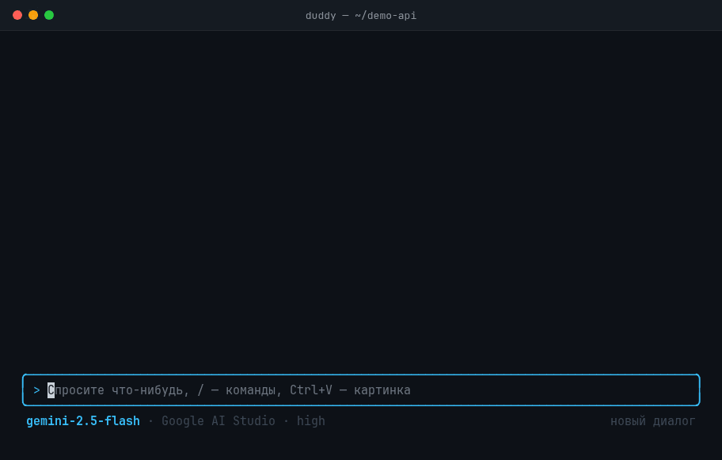
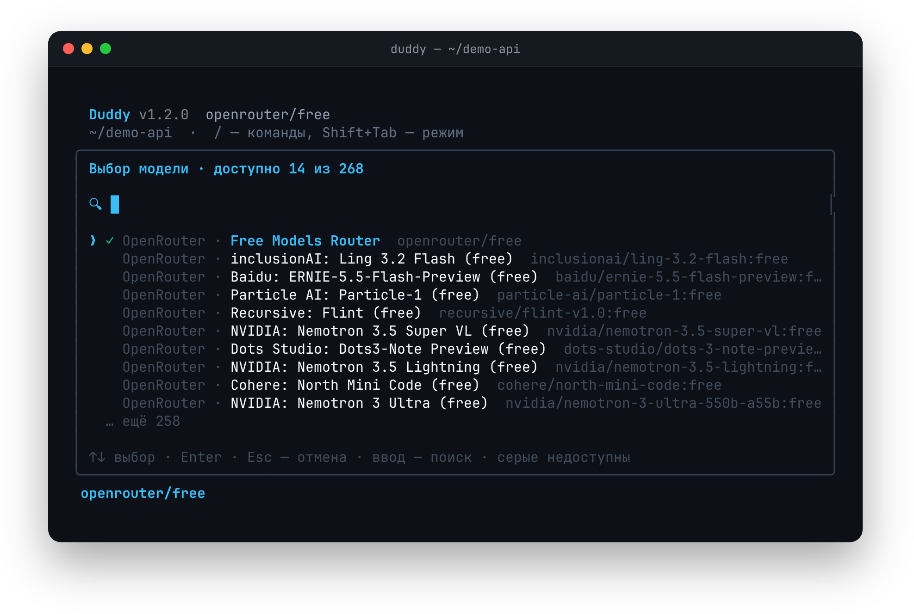
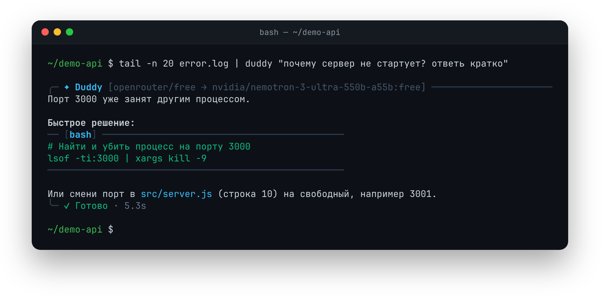
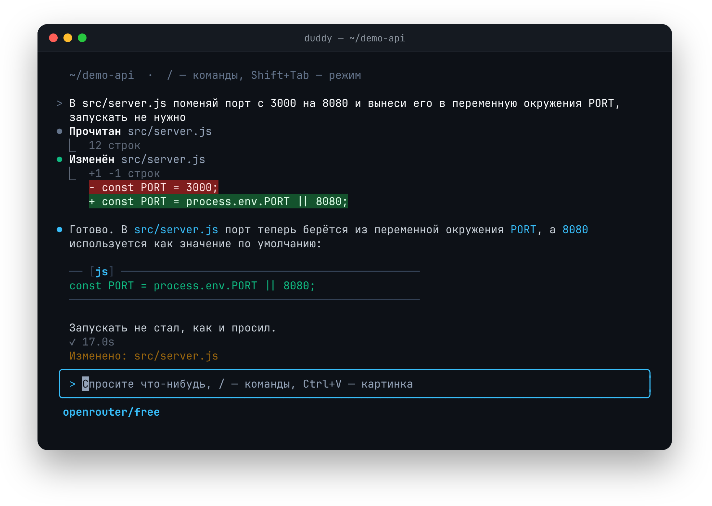
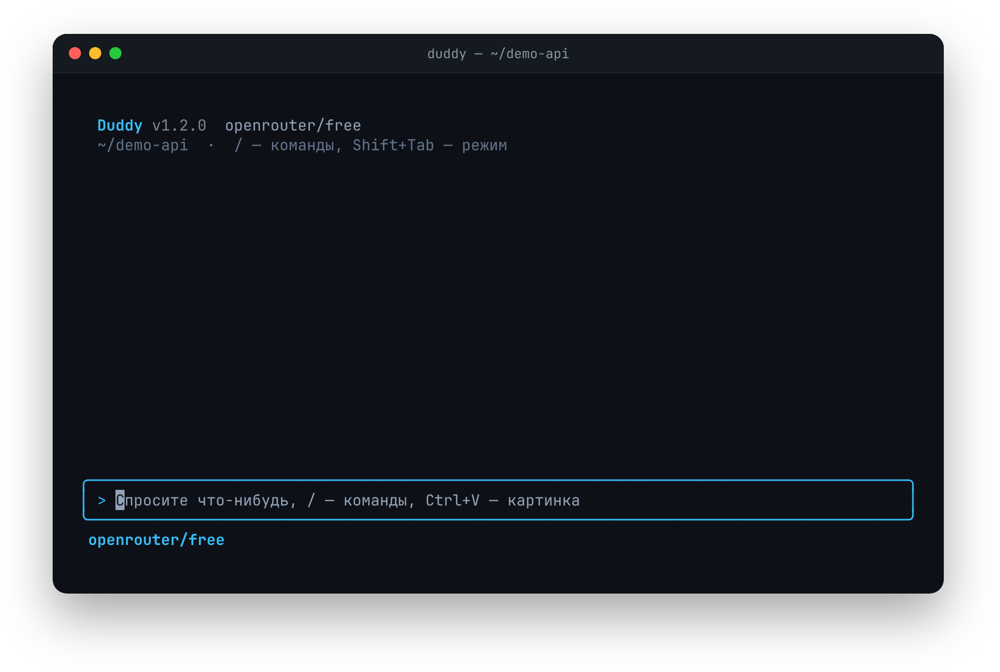
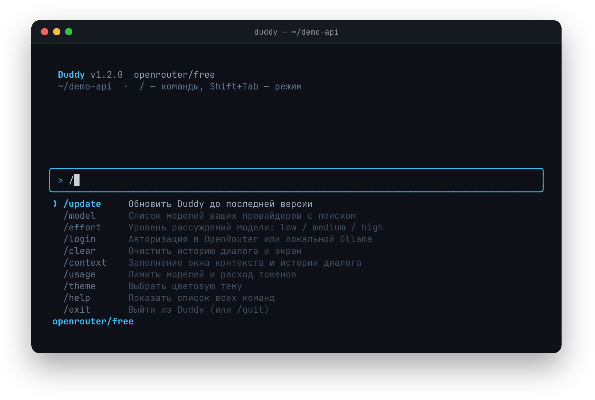
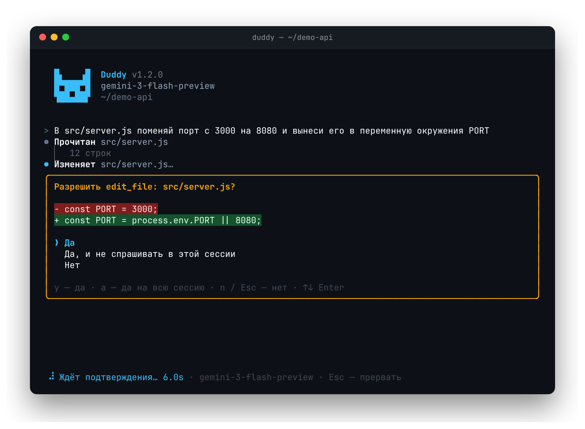

# Duddy

**AI-помощник в терминале для Linux и DevOps.**

[](package.json)
[](https://nodejs.org/)
[](LICENSE)
[](#что-нужно-для-работы)

Duddy — это чат с нейросетью прямо в терминале. Он отвечает на вопросы, объясняет ошибки в логах, читает и правит файлы вашего проекта, запускает команды, тесты и сборку. Перед каждым изменением он показывает, что именно собирается сделать, и ждёт вашего «да».

Работает с облачными нейросетями (через OpenRouter, Google AI Studio, xAI) и с локальными моделями через Ollama — тогда данные вообще не уходят с компьютера.

<p align="center">
  
</p>

```bash
duddy                                                # открыть чат
duddy "как посмотреть нагрузку на диск"              # быстрый вопрос
journalctl -u nginx -n 100 | duddy "почему падает?"  # разобрать вывод команды
```

---

## Содержание

- [Что умеет](#что-умеет)
- [Что нужно для работы](#что-нужно-для-работы)
- [Установка, обновление, удаление](#установка-обновление-удаление)
- [Первый запуск](#первый-запуск)
- [Откуда берутся модели](#откуда-берутся-модели)
  - [Память локальной модели](#память-локальной-модели-размер-контекста)
- [Как пользоваться](#как-пользоваться)
- [Экран чата](#экран-чата)
- [Команды чата](#команды-чата)
- [Режимы: сколько Duddy может делать сам](#режимы-сколько-duddy-может-делать-сам)
- [Безопасность](#безопасность)
- [Как Duddy экономит токены](#как-duddy-экономит-токены)
- [Где хранятся настройки](#где-хранятся-настройки)
- [Ограничения](#ограничения)
- [Частые проблемы](#частые-проблемы)
- [Для разработчиков](#для-разработчиков)
- [Лицензия](#лицензия)

---

## Что умеет

- **Отвечает на вопросы** про Linux, команды, настройку серверов, код.
- **Разбирает вывод команд и логи.** Передайте лог через `|`, и Duddy объяснит, в чём проблема.
- **Работает с проектом в текущей папке.** Ищет нужный код, читает файлы, создаёт и правит их, удаляет лишнее.
- **Запускает команды.** Тесты, сборку, `git` и другие. Опасные команды всегда спрашивает отдельно.
- **Понимает картинки.** Можно вставить скриншот ошибки через `Ctrl+V`.
- **Ничего не меняет молча.** Перед правкой файла показывает, какие строки изменятся. Вы решаете: да, да для всех правок до конца сессии, или нет.
- **Бережёт секреты.** Файлы вроде `.env`, SSH-ключи и пароли не отправляются нейросети без вашего отдельного разрешения.
- **Поддерживает четыре источника моделей** в одном списке: OpenRouter, Google AI Studio, xAI (Grok) и локальную Ollama. Переключение — командой `/model`.
- **Есть бесплатный вариант.** По умолчанию стоит `openrouter/free` — бесплатные модели OpenRouter. А с Ollama всё работает без интернета и без денег.

---

## Что нужно для работы

| Что                                                                  | Версия     | Зачем                                                   |
| :------------------------------------------------------------------- | :--------- | :------------------------------------------------------ |
| Linux                                                                | любая      | Основная система, на которой проверяется Duddy          |
| [Node.js](https://nodejs.org/)                                       | 22 и новее | На нём написан Duddy                                    |
| git                                                                  | любая      | Нужен для установки и обновления                        |
| [ripgrep](https://github.com/BurntSushi/ripgrep#installation) (`rg`) | любая      | Быстрый поиск по проекту. Без него поиск не работает    |
| `wl-clipboard` или `xclip`                                           | любая      | Необязательно: вставка картинок из буфера обмена        |
| [Ollama](https://ollama.com/download)                                | любая      | Необязательно: если хотите запускать модели у себя      |

Как поставить `ripgrep`:

```bash
sudo pacman -S ripgrep     # Arch
sudo apt install ripgrep   # Debian / Ubuntu
sudo dnf install ripgrep   # Fedora
```

---

## Установка, обновление, удаление

### Установка одной командой

```bash
curl -fsSL https://raw.githubusercontent.com/rual1sher/duddy-cli/master/install.sh | bash
```

Скрипт скачает Duddy в `~/.local/share/duddy`, поставит зависимости и создаст команду `duddy` в `~/.local/bin`.

### Установка из исходников

```bash
git clone https://github.com/rual1sher/duddy-cli.git
cd duddy-cli
./install.sh
```

В этом случае Duddy запускается прямо из скачанной папки, удалять или переносить её нельзя.

### Если команда `duddy` не находится

Папка `~/.local/bin` должна быть в `PATH`. Установщик сам предупредит, если её там нет. Добавить можно так:

```bash
echo 'export PATH="$HOME/.local/bin:$PATH"' >> ~/.bashrc && source ~/.bashrc
```

Если у вас zsh, замените `~/.bashrc` на `~/.zshrc`.

### Обновление

Запустите ту же команду установки ещё раз. Или, если ставили из исходников, в папке проекта:

```bash
git pull && ./install.sh
```

Настройки и ключи при обновлении сохраняются.

### Удаление

```bash
rm -f ~/.local/bin/duddy          # сама команда
rm -rf ~/.local/share/duddy       # программа (если ставили через curl)
rm -rf ~/.config/duddy            # настройки и ключи
```

Если ставили из исходников, удалите ещё и папку `duddy-cli`.

---

## Первый запуск

1. Наберите `duddy`.
2. Выберите цветовую тему. Это спрашивается только один раз, потом можно поменять командой `/theme`.
3. Подключите источник моделей:
   - **OpenRouter** — проще всего. Откроется браузер, войдите в аккаунт, и Duddy получит ключ сам. Можно и вставить ключ вручную.
   - **Google AI Studio или xAI** — команда `/login google` или `/login xai`, затем вставьте ключ.
   - **Ollama** — ничего делать не надо. Если Ollama запущена, её модели уже есть в списке.
4. Напишите вопрос или задачу. Например: «найди, где в проекте задаётся порт сервера».

---

## Откуда берутся модели

| Источник                      | Как подключить                                                                                | Переменная окружения               | Что важно знать                                                                       |
| :---------------------------- | :-------------------------------------------------------------------------------------------- | :--------------------------------- | :------------------------------------------------------------------------------------ |
| **OpenRouter** (по умолчанию) | Вход через браузер или ключ с [openrouter.ai/keys](https://openrouter.ai/keys)                | `OPENROUTER_API_KEY`               | Сотни моделей: Claude, GPT, Gemini, DeepSeek, Llama. Есть бесплатные (`openrouter/free`) |
| **Google AI Studio**          | `/login google`, ключ с [aistudio.google.com/apikey](https://aistudio.google.com/apikey)      | `GEMINI_API_KEY`, `GOOGLE_API_KEY` | Модели Gemini и Gemma напрямую от Google. Помнят очень длинные разговоры              |
| **xAI**                       | `/login xai`, ключ с [console.x.ai](https://console.x.ai)                                     | `XAI_API_KEY`                      | Модели Grok. Бесплатного тарифа нет, нужно пополнить счёт                              |
| **Ollama**                    | Ничего не нужно                                                                               | `OLLAMA_HOST`                      | Модели работают на вашем компьютере, без интернета                                    |

Ключи сохраняются в `~/.config/duddy/config.json` (файл доступен только вашему пользователю). Если ключ задан и в переменной окружения, и в файле, Duddy берёт переменную.

В списке `/model` собраны модели всех подключённых источников, по названию можно искать. Модели, которые не работают с вашими ключами или сейчас перегружены, видны серым, выбрать их нельзя. Для каждого источника Duddy запоминает последнюю выбранную модель.

<p align="center">
  
</p>

### Локальные модели (Ollama)

```bash
ollama pull qwen3:8b    # скачать модель
duddy                   # и выбрать её через /model, группа «Ollama»
```

- **Подходят не все модели.** Duddy работает с файлами и командами через «инструменты», а их понимают не все модели. Неподходящие видны в списке серыми.
- **Размер модели.** Маленькие модели (2–3 млрд параметров) годятся для простых вопросов, но с файлами и командами почти не справляются: вместо того чтобы прочитать файл, они пишут «выполните `cat file`». Для работы с кодом берите модели от 7–8 млрд, например `qwen3:8b`.
- **Ollama на другом компьютере.** Укажите адрес в `OLLAMA_HOST`, например `OLLAMA_HOST=192.168.1.5:11434 duddy`.
- **Ollama не запущена** — группа просто не показывается, ошибок и задержек не будет.
- **Облегчённый режим.** Для локальных моделей Duddy отправляет более короткий список файлов проекта. А если модель написала вызов инструмента обычным текстом, Duddy всё равно его распознает и выполнит (с теми же подтверждениями).

### Память локальной модели (размер контекста)

> [!IMPORTANT]
> Это самая частая причина, почему локальная модель «тупит»: не читает файлы, забывает начало разговора или выдаёт ошибку. Duddy **не меняет** настройки Ollama сам — размер памяти задаёте вы, один раз.

**Что это.** У модели есть «память» — сколько текста она держит в голове за раз. Это называется окном контекста (в Ollama — `num_ctx` / `OLLAMA_CONTEXT_LENGTH`) и меряется в токенах. Токен — это примерно кусочек слова.

**Почему по умолчанию мало.** Ollama сама выбирает окно по размеру видеопамяти. На обычном компьютере без мощной видеокарты это всего **4 096 токенов**. А Duddy ещё до вашего вопроса отправляет около 3 000: правила, описание инструментов и список файлов. После пары прочитанных файлов память заканчивается.

**Как это выглядит:**

- Duddy пишет: «Память модели почти заполнена…»;
- ошибка `exceeds the available context size`;
- модель забывает, о чём шла речь, или перестаёт пользоваться инструментами.

**Как увеличить.** Задайте для Ollama настройку `OLLAMA_CONTEXT_LENGTH` с нужным размером (например, `16384`) и перезапустите Ollama. Как это сделать на вашей системе, написано в официальной инструкции Ollama: [How can I specify the context window size?](https://docs.ollama.com/faq#how-can-i-specify-the-context-window-size). Сам Duddy эту настройку не меняет.

**Как проверить.** Задайте Duddy любой вопрос, затем выполните `ollama ps`. В колонке `CONTEXT` должно быть новое число:

```
NAME        SIZE      PROCESSOR    CONTEXT    UNTIL
qwen3:8b    9.1 GB    100% GPU     32768      4 minutes from now
```

**Какой размер выбрать.** Больше память модели — больше нужно оперативной памяти (или видеопамяти). Примерно:

| Размер модели | Сама модель занимает | Каждые +8 000 токенов окна | Рекомендуемое окно |
| :------------ | :------------------- | :------------------------- | :----------------- |
| 3–4 млрд      | ~2–3 ГБ              | ~+0,5 ГБ                   | 16 384             |
| 7–8 млрд      | ~5 ГБ                | ~+1 ГБ                     | 16 384–32 768      |
| 12–14 млрд    | ~8–9 ГБ              | ~+1,5 ГБ                   | 16 384–32 768      |

Если памяти не хватает, Ollama начинает работать очень медленно или падает. Тогда уменьшите окно или возьмите модель поменьше. Минимум для нормальной работы Duddy — **16 384**.

> [!NOTE]
> **Облачные модели** (OpenRouter, Google AI Studio, xAI) ничего настраивать не нужно: у них большая память, её задаёт сам провайдер. Если в очень длинном разговоре модель начала путаться, начните заново через `/clear`.

---

## Как пользоваться

### Чат

```bash
duddy
```

Обычный разговор с историей. Duddy помнит, о чём шла речь, и спрашивает разрешения перед действиями.

### Быстрый вопрос

```bash
duddy "как найти процесс, который занимает порт 8080"
```

Ответ печатается в терминал, и программа завершается.

### Разбор вывода другой команды

Всё, что пришло через `|`, Duddy добавляет к вопросу:

```bash
tail -n 50 /var/log/syslog | duddy "в чём тут ошибка?"
git diff | duddy "напиши сообщение для коммита"
docker logs myapp 2>&1 | duddy "почему контейнер перезапускается?"
```

<p align="center">
  
</p>

### Работа с проектом

Duddy работает в той папке, где его запустили. Перейдите в проект и дайте задачу:

```bash
cd ~/my-project
duddy "прочитай package.json и скажи, каких зависимостей не хватает"
duddy "замени в index.js порт 3000 на 8080"
duddy "запусти тесты и почини то, что падает"
```

<p align="center">
  
</p>

### Флаги

| Флаг              | Что делает                                                                              |
| :---------------- | :-------------------------------------------------------------------------------------- |
| `-y`, `--yes`     | Не спрашивать подтверждение для правок файлов и обычных команд. В чате сразу включает режим «Авто» |
| `-h`, `--help`    | Показать справку                                                                        |
| `-v`, `--version` | Показать версию                                                                         |

> [!WARNING]
> Не используйте `--yes`, если передаёте чужие данные: логи с сервера, текст из интернета. В таком тексте могут быть спрятаны «команды» для нейросети, и она может их выполнить. Опасные команды и доступ к секретам всё равно спрашиваются, но правки файлов — нет.

---

## Экран чата

<p align="center">
  
  
</p>

- **Сверху** — приветствие и история разговора. **Снизу** — поле ввода и строка состояния. Когда сообщений становится много, экран прокручивается как обычный терминал.
- **Пока Duddy работает**, под последним сообщением видно, чем он занят («Думает», «Рассуждает», «Выполняет инструменты», «Ждёт подтверждения») и сколько времени прошло. В строке состояния крутится индикатор.
- **Можно писать, не дожидаясь ответа.** Сообщение встанет в очередь и попадёт к нейросети после текущего шага.
- **Если что-то сломалось** (оборвалась сеть, вы нажали `Esc`), сделанная работа не теряется. Просто напишите «продолжай».
- **Картинки.** `Ctrl+V` вставляет картинку из буфера, или вставьте путь к файлу. Подходят PNG, JPEG, WebP и GIF, до 5 штук в сообщении и до 5 МБ каждая.
- **Длинный текст** при вставке склеивается в одну строку.
- **Темы:** тёмная, светлая и их варианты для людей, которые плохо различают цвета.
- **После итога каждого ответа** видно, сколько токенов ушло, например `↑ 12.3k ↓ 800 · кэш 9.0k` (отправлено, получено, взято из кэша).

### Клавиши

| Клавиши     | Что делает                                   |
| :---------- | :------------------------------------------- |
| `Enter`     | Отправить сообщение                          |
| `↑` / `↓`   | Предыдущие сообщения, движение по меню       |
| `Tab`       | Дописать команду из меню                     |
| `Esc`       | Остановить ответ или очистить поле ввода и прикреплённые картинки |
| `Shift+Tab` | Сменить режим (см. ниже)                     |
| `Ctrl+V`    | Вставить картинку из буфера                  |
| `Ctrl+C`    | Во время ответа — остановить его. Дважды подряд — выйти |

---

## Команды чата

Наберите `/`, чтобы открыть меню команд.

| Команда    | Короткие варианты              | Что делает                                                |
| :--------- | :----------------------------- | :-------------------------------------------------------- |
| `/model`   | `/m`, `/models`                | Выбрать модель (с поиском). Можно сразу: `/model имя`     |
| `/effort`  | `/think`                       | Как долго модель «думает»: `low`, `medium`, `high`, `auto` |
| `/login`   | `/auth`, `/key`                | Подключить OpenRouter, Google AI Studio или xAI           |
| `/theme`   | `/themes`, `/color`, `/colors` | Сменить цветовую тему                                     |
| `/clear`   | `/cls`, `/reset`               | Забыть разговор и начать заново                           |
| `/context` | `/ctx`                         | Сколько памяти модели уже занято                          |
| `/usage`   | `/stats`                       | Лимиты моделей и сколько токенов потрачено                |
| `/help`    | `/?`, `/`                      | Список команд                                             |
| `/exit`    | `/q`, `/quit`                  | Выйти                                                     |

**Про `/effort`.** `high` — модель дольше думает и лучше решает сложные задачи, но тратит больше токенов. `low` — быстрее и дешевле. `auto` — модель решает сама. Если модель не умеет так настраиваться, Duddy предупредит и отправит запрос без этой настройки.

**Про `/usage`.** Источники не сообщают свои лимиты заранее, поэтому Duddy показывает то, что смог узнать:

- **OpenRouter** — дневной лимит бесплатных моделей и остаток на балансе.
- **Google AI Studio и xAI** — лимиты, которые пришли в последнем ответе или в ошибке «слишком много запросов». Точные цифры — в личном кабинете.
- **Ollama** — лимитов нет.
- **Счётчики за день** Duddy ведёт сам (день считается по UTC). Запросы, сделанные не через Duddy, в них не попадают.

---

## Режимы: сколько Duddy может делать сам

Режим меняется клавишами `Shift+Tab` по кругу. Текущий режим виден в строке состояния.

| Режим                         | Файлы                          | Команды                                         |
| :---------------------------- | :----------------------------- | :---------------------------------------------- |
| **Обычный**                   | Каждую правку спрашивает       | Безобидные (`ls`, `git status`) сразу, остальные спрашивает |
| **⏵⏵ Правки без подтверждения** | Правит без вопросов            | Спрашивает                                      |
| **⏸ План**                    | Только читает, менять не может | Только безобидные команды для просмотра         |
| **⏵⏵⏵ Авто**                  | Правит без вопросов            | Обычные команды выполняет без вопросов          |

**План** удобен, когда нужно сначала обсудить, что делать, и быть уверенным, что ничего не изменится.

> [!NOTE]
> Доступ к секретам и опасные команды (`sudo`, `rm -rf`, `git push`, `curl` и т. п.) спрашиваются в любом режиме.

---

## Безопасность

### Файлы

<p align="center">
  
</p>

- **Читать и искать** Duddy может без вопросов (кроме файлов с секретами).
- **Создать, изменить или удалить** — только после вашего ответа. Перед этим он показывает: какие строки меняются, начало нового файла или сколько всего будет удалено. Ответы: `y` — да, `a` — да для всех таких действий до конца сессии, `n` — нет.
- **Только внутри папки проекта.** Выйти выше через `../` или через ссылки на другие папки нельзя.
- **Защита от потери данных:**
  - чтобы полностью перезаписать файл, модель должна сначала прочитать его целиком;
  - очень большие файлы (больше 40 000 символов) и файлы не в UTF-8 целиком не перезаписываются;
  - если файл изменился, пока вы думали над подтверждением, запись отменяется.

### Секреты

- Duddy узнаёт секреты по имени файла и по содержимому: `.env`, приватные ключи, папки `.ssh` и `.aws`, файлы с паролями, история команд shell.
- Доступ к каждому такому файлу спрашивается отдельно. Варианта «разрешить на всю сессию» нет, по умолчанию выбран отказ, а `--yes` эту проверку не отключает. Если спросить некого (нет терминала), доступ запрещается.
- Разрешённый секрет уходит нейросети только один раз. В истории разговора вместо него остаётся заглушка.
- К папке `~/.config/duddy` с вашими ключами у модели доступа нет совсем.
- Шаблоны вроде `.env.example` читаются свободно.

### Команды

Команды выполняются в папке проекта, без возможности что-то ввести с клавиатуры. На одну команду даётся 2 минуты (если модель попросит — до 10). `Esc` останавливает команду вместе со всем, что она запустила.

| Тип          | Примеры                                                                         | Что происходит                                                     |
| :----------- | :------------------------------------------------------------------------------ | :----------------------------------------------------------------- |
| Безобидные   | `pwd`, `ls`, `git status`, `git log`, `git diff`, `node --version`              | Выполняются сразу                                                  |
| Обычные      | `npm test`, `make`, `git commit`                                                | Спрашивается: `y` — один раз, `a` — разрешить эту команду до `/clear` |
| Опасные      | `sudo`, `rm -rf`, `git push`, `git reset --hard`, `curl`, `ssh`, `systemctl`, `kill`, `apt`/`pacman`, запись вне проекта | Спрашивается каждый раз, по умолчанию «нет». `--yes` не помогает |
| Запрещённые  | всё, что трогает `~/.config/duddy`                                              | Не выполняются никогда                                             |

Ключи и пароли из переменных окружения (`*_API_KEY`, `*_TOKEN`, `*SECRET*`, `*PASSWORD*`) команде не передаются. Если в выводе команды есть что-то похожее на секрет, Duddy сначала спросит, можно ли показать этот вывод модели (по умолчанию «нет»). Длинный вывод обрезается: остаются начало и конец.

> [!WARNING]
> Duddy не запускает команды в отдельной «песочнице». Они выполняются от вашего имени и видят всю систему. Список опасных команд ловит обычные случаи, но его можно обойти — например, если модель сама напишет скрипт и запустит его. Главная защита — ваше подтверждение. Читайте, что разрешаете.

---

## Как Duddy экономит токены

Токены — это то, за что платят нейросетям (и что ограничивает бесплатные тарифы). Duddy старается тратить их меньше:

- **Ищет, а не читает всё подряд.** Сначала находит нужное место поиском, потом читает только нужные строки.
- **Сразу знает проект.** При запуске он передаёт модели список файлов и начало `AGENTS.md` или `CLAUDE.md`, если такой файл есть. Обычно это около 2 000 токенов. Файлы с похожим на секреты содержимым туда не попадают.
- **Не повторяется.** Файл, который уже прочитан и не менялся, второй раз не отправляется.
- **Сжимает старое.** Когда результатов работы становится много, самые старые заменяются короткой пометкой. В истории длинные результаты укорачиваются.
- **Использует кэш.** Повторяющаяся часть запроса берётся из кэша источника, это дешевле. Для Claude через OpenRouter Duddy включает кэш сам, у Gemini, GPT и Grok он работает автоматически.

---

## Где хранятся настройки

| Файл                                 | Что в нём                                                  |
| :----------------------------------- | :--------------------------------------------------------- |
| `~/.config/duddy/config.json`        | Ключи, выбранная модель, тема, уровень `/effort`           |
| `~/.config/duddy/models-status.json` | Какие модели не работают с вашими ключами                  |
| `~/.config/duddy/model-limits.json`  | Счётчики запросов и токенов за день                        |

| Переменная окружения               | Зачем                                                   |
| :--------------------------------- | :------------------------------------------------------ |
| `OPENROUTER_API_KEY`               | Ключ OpenRouter                                         |
| `GEMINI_API_KEY`, `GOOGLE_API_KEY` | Ключ Google AI Studio                                   |
| `XAI_API_KEY`                      | Ключ xAI                                                |
| `OLLAMA_HOST`                      | Адрес Ollama (по умолчанию `localhost:11434`)           |
| `DUDDY_NO_ANIMATION=1`             | Выключить анимацию на стартовом экране                  |

---

## Ограничения

- **10 шагов на одну задачу.** Шаг — это одно действие: прочитать файл, запустить команду и т. п. Если задача большая и шаги кончились, напишите «продолжай».
- **Память на 10 сообщений.** Duddy помнит последние 10 ваших сообщений, более старые забываются. В длинном разговоре на новую тему лучше сделать `/clear`.
- **Ожидание ответа — до 10 минут.** Если модель молчит дольше, запрос прерывается.
- **Большие файлы читаются частями** по 40 000 символов. Бинарные файлы (картинки, архивы, программы) не читаются.
- **Команды без ввода.** Нельзя запустить то, что ждёт ввода с клавиатуры, сервер или программу, которая работает бесконечно.
- **Только Linux.** На других системах Duddy может работать, но это не проверяется.

---

## Частые проблемы

**`duddy: command not found`.** Папки `~/.local/bin` нет в `PATH`. Смотрите [выше](#если-команда-duddy-не-находится).

**Поиск по проекту не работает.** Не установлен `ripgrep`. Поставьте его ([как](#что-нужно-для-работы)).

**`API key not configured` при быстром вопросе.** Ключ ещё не задан. Запустите `duddy` и подключитесь через `/login`, или задайте переменную окружения.

**Локальная модель «тупит»: не читает файлы, забывает разговор, ошибка `exceeds the available context size`.** Почти всегда ей не хватает памяти. Увеличьте её — смотрите [Память локальной модели](#память-локальной-модели-размер-контекста). Если не помогло, модель слишком маленькая: возьмите от 7–8 млрд параметров.

**Модель серая в `/model`.** Она не работает с вашим ключом, перегружена или (для Ollama) не умеет работать с инструментами. Выберите другую.

**Ошибка 429 / «слишком много запросов».** Закончился лимит у источника. Посмотрите `/usage`, подождите или смените модель.

**Не вставляется картинка.** Установите `wl-clipboard` (Wayland) или `xclip` (X11).

---

## Для разработчиков

```bash
git clone https://github.com/rual1sher/duddy-cli.git
cd duddy-cli
npm install
npm test
```

Тесты используют встроенный в Node.js `node:test`, лежат в `test/` и не требуют интернета и ключей.

Устройство проекта коротко:

```
bin/duddy.js          Запуск: флаги, быстрый вопрос, работа через |, старт чата
src/agent.js          Цикл агента: запрос к модели → действия → следующий запрос
src/llm/              Связь с моделями: потоковый ответ, сжатие истории
src/models/           Списки моделей у каждого источника, лимиты
src/tools/            Действия агента (файлы, поиск, команды) и защита
src/ui/               Интерфейс чата на React и Ink
src/providers.js      Описание источников моделей
src/config.js         Настройки и системный промпт
```

Все источники подключаются через один и тот же OpenAI-совместимый API (библиотека `openai`). Подробное описание для разработчиков и AI-агентов — в [agents.md](agents.md).

---

## Лицензия

[MIT](LICENSE) © 2026 alisher
